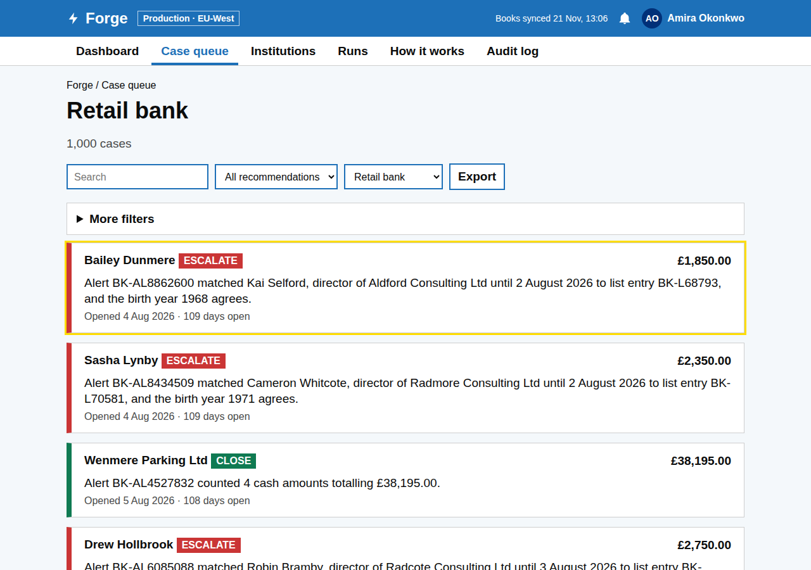

# Forge

Transaction-monitoring triage for four UK firms. One recommendation per case: close, ask, or escalate.



## Quick start

You need Python 3.12, Node 22, and the .NET 8 SDK.

```bash
bash scripts/fetch_hackathon_data.sh
./dev.sh
```

The desk is at http://127.0.0.1:43123 and the API at http://127.0.0.1:43124.

Score one institution folder. The working directory does not matter.

```bash
python3 system/run path/to/institution_folder path/to/output.jsonl
```

A 200-case folder takes about 0.07s here. A 1,000-case book takes about half a second.

Optional reviewer, not used by `system/run`:

```bash
cp .env.example .env
```

## Layout

- `system/` scored policy engine (`system/run`)
- `backend/` ASP.NET Core API
- `frontend/` React desk
- `ml/` risk-score training. The score is not loaded by `system/run`
- `output/` decisions for the development books
- `fixtures/` small books for tests
- `docs/` audit notes, demo script, and how the checks were run

## How it works

`system/run` reads the folder you pass and writes one JSON line per case. A case closes only when every alert is explained by a document, a statement, or a record on file. A missing document becomes a request that names what to ask for. Suspicion is escalated. The desk shows that recommendation. Analyst overrides are stored by the API and appended to the audit log.

Details, including the cross-validation numbers, are in the desk under How it works, and in `docs/`.

## Tests

```bash
make lint
python3 -m pytest tests
```
